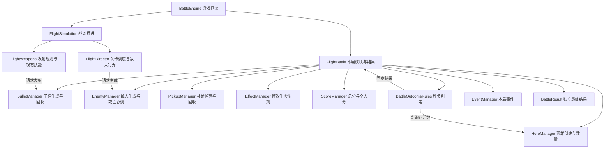
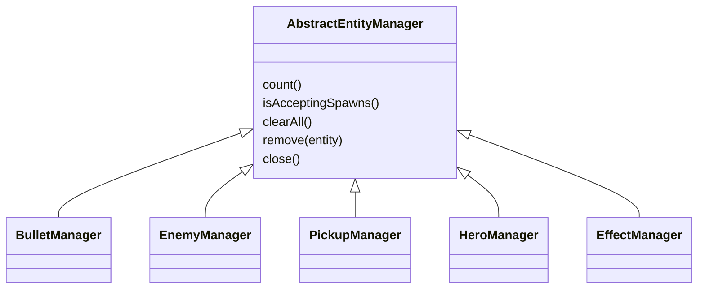
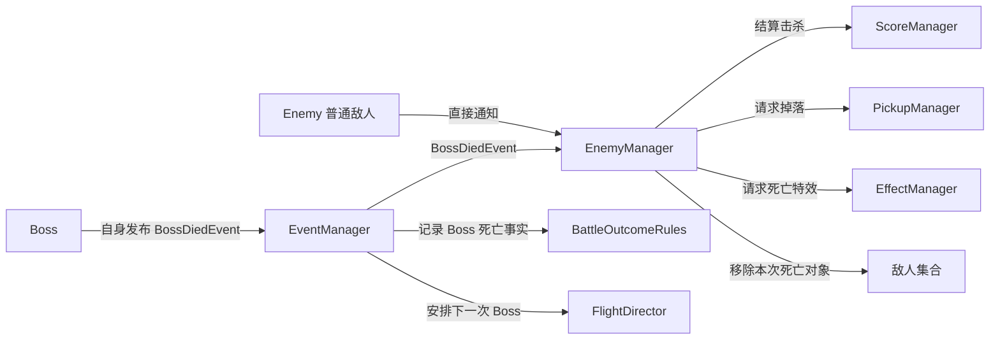
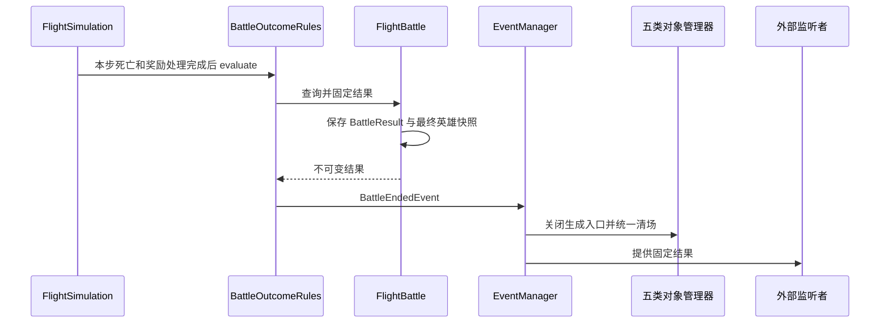

# 飞机战斗重构架构

本版将对象生命周期、普通敌人死亡协调、计分、胜负判定与结束结果分开。模拟步长和调度时钟沿用现有实现，网络协议及 Android 绘制接口保持兼容。初始化仍沿用现有自动进入运行状态的接口，四阶段中的显式等待和开始接口留待后续设计。

## 框架与业务模块



`BattleEngine.step()` 保留原有时间推进算法。单机调度仍在 `LocalSession`，服务端调度仍在 `RoomServer`，没有增加新的时钟模块。`FlightSimulation` 在安全的结算位置调用胜负判定，不在集合遍历期间清空整个战场。

`FlightDirector` 继续提供原有生成时机、敌人类型、属性和行为规则；实际敌人创建、登记、数量上限及生成停止由 `EnemyManager` 执行。普通子弹的实际创建统一进入 `BulletManager`。冲击波、光波、冲刺路径伤害和炸弹清屏保留原有实现，本版没有为它们引入新的攻击模型。

## 对象管理器继承



父类集中维护集合生命周期、结束时停止生成及统一清空，提供单对象资源释放扩展点。清场与击杀、拾取是不同操作：`clearAll()` 不计分、不掉落、不发布死亡事件。各管理器只清理自己持有的对象；事件与得分管理器不属于这个继承体系。

## 死亡与计分



普通敌人死亡不广播。Boss 自己发布一次死亡事件，不再同时走普通敌人通知路径。敌人管理器将两种死亡入口汇入同一结算逻辑，得分管理器是唯一的分数修改者；补给拾取也通过得分管理器计分。

个人分数暂定保存在 `ScoreManager` 内部的“英雄归属 ID → 得分”映射中，脱离英雄对象生命周期。英雄管理器只提供身份，不依赖得分管理器。旧 `GameState.score` 和 `Pilot.score` 在输出快照时由框架填写，属于兼容读取的数据投影，不是另一套可独立计分的数据源。

## 结束事件与结果



`BattleResult` 包含胜负、结构化原因、总分、英雄编号与名称及个人分数、战斗用时、关卡、难度、模式和开发者标记。当前结束原因为 Boss 被击败或英雄全部倒地；无尽击败 Boss 不结束。胜负冲突没有新增策略，保留现有闯关 Boss 胜利优先行为。

胜利和失败都清空活动子弹、敌人、补给、英雄和战斗特效。最终结果与实体无引用关系。为兼容现有客户端和服务端仍读取 `pilots` 的接口，结束后的 `snapshot()` 保留独立的英雄值副本，其余活动对象列表为空；实际英雄管理器已清空。这些最终英雄值不会继续参与战斗。

事件按局隔离、同步按确切类型分发。订阅可单独解除，`BattleEngine.close()` 释放管理器和事件订阅。结束结果在事件发布前已保存，不依赖监听者顺序完成计分；某个监听者抛出运行时异常也不会阻止剩余监听者接收本次事件。

外部使用入口：

```java
EventManager.Subscription subscription = engine.onBattleEnded(event -> {
    BattleResult result = event.result;
    // 回调位于模拟线程；界面调用方应自行切换到 UI 线程。
});
BattleResult result = engine.result(); // 飞行战斗尚未结束时为 null
subscription.close();
```

新增结束事件和结果查询适用于飞机战斗；夜班的模拟与结束行为保留。新结果没有加入网络协议，现有网络仍使用兼容的 `GameState` 快照。主动放弃、无归属击杀、动态重生归属、显式等待开始状态和特殊攻击模型仍待后续讨论。

## 验证入口

`shared:check` 已接入 `BattleLifecycleTest`，覆盖普通死亡与拾取仅结算一次、Boss 单次事件、最后击杀分进入结果、胜败清场、结束后拒绝生成、无尽继续、个人分数脱离英雄存活周期、最终快照兼容和订阅隔离。

纯 JVM 验证可运行 `:shared:verifyCore :shared:verifyMinuteCampaign :shared:verifyBattleLifecycle`。Android 的原生构建仍需要已有构建说明中的 SDK 环境。
