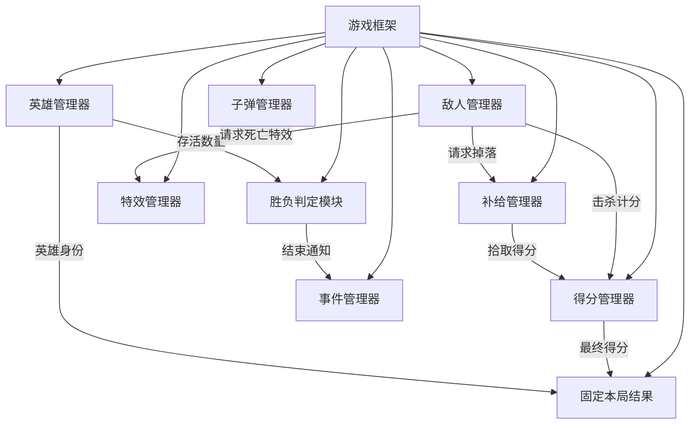
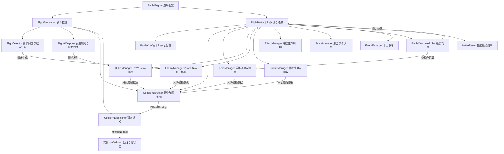
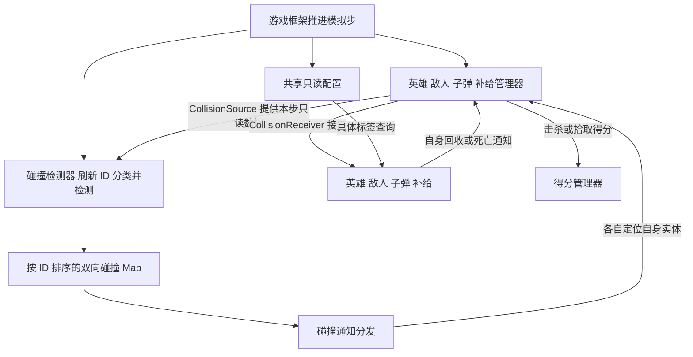
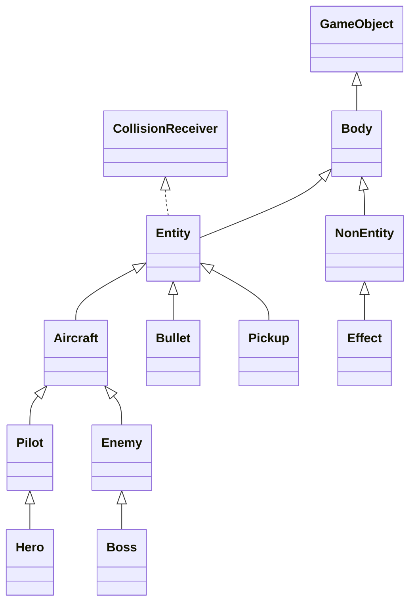
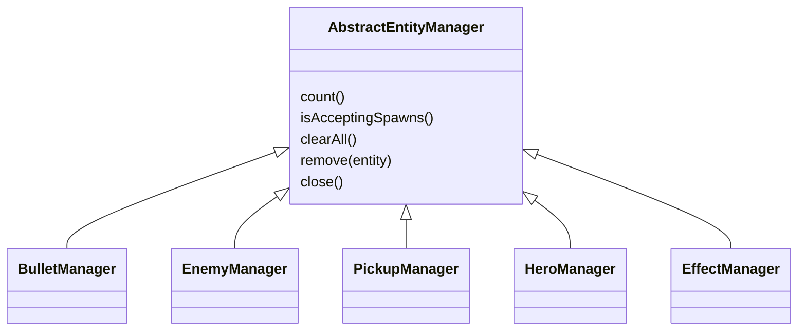
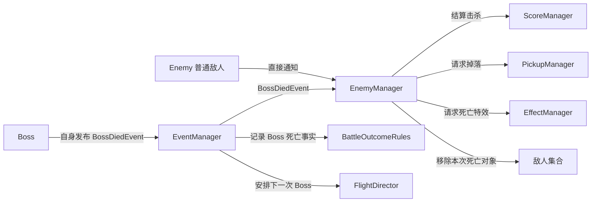
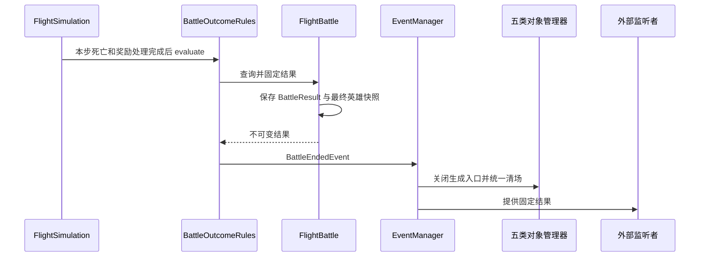

# 飞机战斗重构架构

本版将对象生命周期、碰撞检测、实体碰撞处理、死亡协调、计分、胜负判定与结束结果分开。模拟步长和调度时钟沿用现有实现，网络协议及 Android 绘制接口保持兼容。初始化仍沿用现有自动进入运行状态的接口，四阶段中的显式等待和开始接口留待后续设计。

## 管理器逻辑架构



五类对象管理器负责各自的生成、数量和回收；得分管理器统一维护分数，事件管理器负责本局通知，胜负判定模块决定结束。游戏框架协调模拟步，并查询数据固定最终结果。技能管理器仍属后续设计，不计入当前已实现的管理器。

## 框架与业务模块



`BattleEngine.step()` 保留原有时间推进算法。单机调度仍在 `LocalSession`，服务端调度仍在 `RoomServer`，没有增加新的时钟模块。`FlightSimulation` 在安全的结算位置调用胜负判定，不在集合遍历期间清空整个战场。

`FlightDirector` 继续提供原有生成时机、敌人类型、属性和行为规则；实际敌人创建、登记、数量上限及生成停止由 `EnemyManager` 执行。普通子弹的实际创建统一进入 `BulletManager`。冲击波、光波、冲刺路径伤害和炸弹清屏保留原有实现，本版没有为它们引入新的攻击模型。

## 普通碰撞调用架构



每个模拟步先完成移动与越界回收，再通过 `CollisionSource` 收集当前对象。`CollisionDetector.detectPairs()` 仅配对英雄子弹与敌人、敌弹与英雄、敌人与英雄、补给与英雄；英雄三个判定半径从配置读取，分别为 12、15、18。圆形检测使用距离平方，相切算接触。特效不是实体，不进入检测。

检测器每批刷新 `ID → 碰撞数据` 和 `类型 → ID 集合`，不持有完整实体、实体回调或管理器业务引用。正式结果为只读的 `Map<Integer, Set<CollisionInfo>>`，key 和集合中的对方 ID 均升序，双方各有一条邻接关系。`CollisionInfo` 保存对方 ID、类型、具体配置标签、速度分量与计分归属，不保存坐标、实体引用或计算后的伤害。碰撞数据先收集再处理，因此死亡新掉落的补给下一模拟步才参与检测。

`CollisionDispatcher` 逐对通知，每对只调度一次；对应管理器通过自身 ID 索引定位实体，调用 `CollisionReceiver.onCollision()`，双方各处理自身部分。英雄内部处理受伤、无敌和补给效果，敌人内部处理护盾、受伤及死亡，子弹和补给内部请求自身回收。一方先回收不会删除已经保存的对方标签、速度和归属，也不会取消同次另一方通知。回收在本模拟步内完成。

多目标冲突的最终策略尚未定稿。当前独立的 `CollisionDetector.acceptContact()` 仅使用第一版临时规则：按 ID 顺序选择仍有效的配对，非穿透子弹和补给只接受一次，单个敌人机体同一步仅与一位英雄结算接触。几何 Map 仍完整保留所有候选；后续可单独替换冲突函数，不改圆形算法和实体回调。该顺序可能改变原来依赖列表倒序的重叠目标选择。

## 实体继承与兼容数据



`Body` 和 `Pilot` 是现有 `GameState` 快照形状的兼容层，所以实际继承图保留这两层；活跃对象分别创建为 `Hero`、`Enemy/Boss`、`Bullet`、`Pickup` 和 `Effect`。快照仍复制为普通 `Body/Pilot` 值，不携带管理器、战斗上下文或活跃实体。背景仍由现有绘制层生成，本版不增加背景实体或背景管理器。

`BattleEngine` 初始化时创建本局 `EntityIds` 和只读 `BattleConfig`，向管理器注入 ID 生成能力及配置。所有活跃对象使用同一递增 `entityId`，回收不复用。为兼容输入、计分和客户端，`Pilot.id` 继续表示稳定玩家身份；其它对象的旧 `Body.id` 与其 `entityId` 相同。检测器只使用 `entityId`，不能把旧的玩家编号混作实体编号。网络协议保持原有字段，新实体编号无需由远程绘制客户端解析。

普通伤害、英雄三个碰撞半径、护盾速度阈值、受击保护时间、Boss 阶段保护和补给参数位于 `shared/src/main/resources/combat.properties`。框架初始化时加载，实体按具体标签读取；子弹伤害不再从 `hp` 读取，旧帧中的 `hp` 仅保留兼容投影。现有技能的数值和范围检测继续沿用原实现；它们移除子弹时也经过管理器，以同步生命周期和 ID 索引。

## 碰撞调试

`BattleEngine.configureCollisionDebug(enabled, interval, sampleLimit)` 控制采样，默认关闭。通过 `onCollisionDebug()` 订阅的 `CollisionDebugFrameEvent` 包含模拟步、候选数、接触数、检测耗时和限量的世界坐标判定区、接触配对；截断只影响调试样本。详细坐标只进入诊断事件，不进入正式碰撞 Map。诊断监听者异常不打断战斗结算。

```java
// 每 30 个模拟步采样；判定区和接触配对各最多保留 128 条。
engine.configureCollisionDebug(true, 30, 128);

EventManager.Subscription subscription = engine.onCollisionDebug(frame -> {
    System.out.printf("tick=%d candidates=%d contacts=%d time=%dns%n",
        frame.tick, frame.candidatePairs, frame.contacts, frame.detectionNanos);
});

// 不再观察时解除订阅；需要停止生成调试事件时关闭采样。
subscription.close();
engine.configureCollisionDebug(false, 30, 128);
```

| 调试数据 | 字段及含义 |
| --- | --- |
| 所属模拟步 | `tick` |
| 几何统计 | `candidatePairs` 候选配对数、`contacts` 几何接触数、`detectionNanos` 检测耗时 |
| 判定区样本 | `bodies`：ID、类型、配置标签、归属、世界坐标、速度和用途对应的半径 |
| 接触样本 | `samples`：碰撞双方的 ID，每个无序配对只列一次 |
| 截断状态 | `truncated`：判定区或接触样本是否超过上限，不影响正式碰撞结果 |

回调在模拟线程执行，应保持轻量；界面展示需切换线程。事件在本步碰撞分发后发布，保存的是检测时的几何样本，`contacts` 不等于实际伤害次数。当前没有默认输出的逐碰撞日志；示例由订阅方决定日志去向。冲突跳过原因、扣血前后数值、回收原因尚未加入诊断事件，Android 判定圈显示也尚未接入。

## 对象管理器继承



父类集中维护集合生命周期、结束时停止生成及统一清空，提供单对象资源释放扩展点。清场与击杀、拾取是不同操作：`clearAll()` 不计分、不掉落、不发布死亡事件。各管理器只清理自己持有的对象；事件与得分管理器不属于这个继承体系。

## 死亡与计分



普通敌人死亡不广播。Boss 自己发布一次死亡事件，不再同时走普通敌人通知路径。敌人管理器将两种死亡入口汇入同一结算逻辑，得分管理器是唯一的分数修改者；补给拾取也通过得分管理器计分。

个人分数暂定保存在 `ScoreManager` 内部的“英雄归属 ID → 得分”映射中，脱离英雄对象生命周期。英雄管理器只提供身份，不依赖得分管理器。旧 `GameState.score` 和 `Pilot.score` 在输出快照时由框架填写，属于兼容读取的数据投影，不是另一套可独立计分的数据源。

## 结束事件与结果



`BattleResult` 包含胜负、结构化原因、总分、英雄编号与名称及个人分数、战斗用时、关卡、难度、模式和开发者标记。当前结束原因为 Boss 被击败或英雄全部倒地；无尽击败 Boss 不结束。胜负冲突没有新增策略，保留现有闯关 Boss 胜利优先行为。

胜利和失败都清空活动子弹、敌人、补给、英雄和战斗特效。最终结果与实体无引用关系。为兼容现有客户端和服务端仍读取 `pilots` 的接口，结束后的 `snapshot()` 保留独立的英雄值副本，其余活动对象列表为空；实际英雄管理器已清空。这些最终英雄值不会继续参与战斗。

事件按局隔离、同步按确切类型分发。订阅可单独解除，`BattleEngine.close()` 释放管理器和事件订阅。结束结果在事件发布前已保存，不依赖监听者顺序完成计分；某个监听者抛出运行时异常也不会阻止剩余监听者接收本次事件。

外部使用入口：

```java
EventManager.Subscription subscription = engine.onBattleEnded(event -> {
    BattleResult result = event.result;
    // 回调位于模拟线程；界面调用方应自行切换到 UI 线程。
});
BattleResult result = engine.result(); // 飞行战斗尚未结束时为 null
subscription.close();
```

新增结束事件和结果查询适用于飞机战斗；夜班的模拟与结束行为保留。新结果没有加入网络协议，现有网络仍使用兼容的 `GameState` 快照。主动放弃、无归属击杀、动态重生归属、显式等待开始状态和特殊攻击模型仍待后续讨论。

## 验证入口

`shared:check` 已接入 `BattleLifecycleTest` 和 `CollisionTest`。生命周期检查覆盖普通死亡与拾取仅结算一次、Boss 单次事件、最后击杀分进入结果、胜败清场、结束后拒绝生成、无尽继续、个人分数脱离英雄存活周期、最终快照兼容和订阅隔离。新增碰撞检查覆盖圆形相切和三个英雄半径、配对过滤、有序双向 Map、索引刷新与唯一 ID、来源先回收、归属计分、护盾速度判定、免伤、单次消耗、补给下一步参与、补给效果、Boss 阶段保护和调试隔离。

纯 JVM 验证可运行 `:shared:verifyCollisions :shared:verifyCore :shared:verifyMinuteCampaign :shared:verifyBattleLifecycle`。若手工通过 `java -cp` 运行，需同时包含编译类与 `shared/build/resources/main`，以加载战斗配置。Android 的原生构建仍需要已有构建说明中的 SDK 环境。
