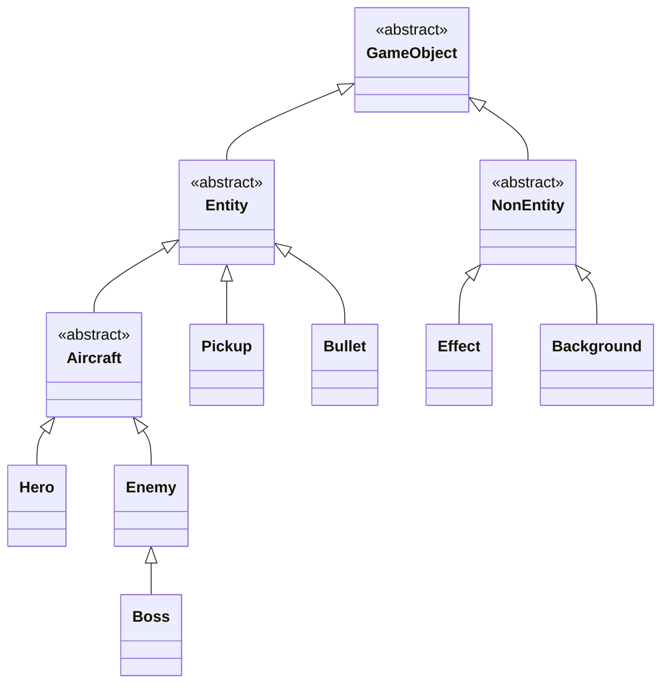

# 飞机大战游戏框架临时草案

日期：2026-11-16。状态：讨论稿。

已完成首版对象管理、死亡协调、计分、胜负判定及结束结果重构，并按后续授权实现普通碰撞检测与实体处理的第一版，以及游戏对象父类的统一更新、移动、环境响应和生命周期回收；英雄、敌人、Boss、子弹、补给与特效通过继承重写各自规则。实际类关系、已迁移内容、临时冲突策略与兼容边界见 [飞机战斗重构架构](flight-battle-architecture.md)。下文保留逐步形成的设计讨论，其中“不修改代码”等表述记录当时的讨论范围，不表示当前实现状态；显式等待和开始接口等未确定部分仍未实现。

本轮讨论飞机战斗的生命周期、场上对象及规则职责，覆盖现有五关和无尽模式的战斗规则。机库夜班不纳入本轮设计，也不为它增加共用抽象。网络、输入适配和绘制实现沿用现有边界。

背景和 UI 保留在最初的游戏组成分类中，本轮仅标明它们与战斗核心的边界，不展开其内部结构。剧情、菜单、成绩存档及跨关流程也不属于本轮飞机战斗逻辑。

## 用户提出的初步方案

游戏分为初始化阶段、等待开始阶段、正式战斗阶段和结束阶段。场上组件先分为英雄、敌人、子弹、补给、背景、UI 等。

这里的“组件”先按游戏组成部分理解，不表示已经选用 ECS，也不要求这些类别继承同一个父类。以下阶段顺序和职责细分为分析建议。

## 四阶段的职责与流转建议

通常顺序为：初始化 → 等待开始 → 正式战斗 → 结束。

| 阶段 | 主要职责 | 时间与对象更新 | 离开条件 |
| --- | --- | --- | --- |
| 初始化 | 读取本局配置，创建战场和初始对象，设置随机种子，重置计时器、得分及规则状态 | 不推进战斗时间，不刷怪或攻击 | 初始化成功后进入等待开始；失败或取消时清理并退出 |
| 等待开始 | 保持已准备的战场，等待开始条件满足 | 不推进战斗时间，不刷怪、不攻击、不扣冷却 | 收到开始请求且准备条件满足 |
| 正式战斗 | 按约定顺序执行移动、敌人行为、攻击、碰撞、伤害、死亡、掉落和胜负判定 | 推进战斗时间及对象状态 | 达成胜负条件，或主动放弃 |
| 结束 | 固定本局结果，形成得分与通关结算数据，保留必要的最终战场状态 | 停止影响结果的战斗更新；允许外部继续展示结束表现 | 重试、进入下一关或退出 |

建议由统一的生命周期管理者执行阶段切换，各业务规则只提出“结束本局”等请求，避免多个模块各自切换阶段。

重试或进入下一关应重新经过初始化，不能只将阶段改回正式战斗；需要同时重置实体、计时器、技能状态、随机过程和关卡进度。初始化、开始和结束处理应保证一次转换只生效一次。

### 四阶段之外需要补充的情况

- 暂停与恢复：优先作为正式战斗的运行控制，暂停时冻结战斗时间与业务更新，恢复后继续原战场。暂不决定是否增加独立的暂停阶段。
- 退出与清理：结束后的结果保留与最终资源清理应分开。初始化、等待和战斗中都可能取消，清理不能只挂在正常胜负之后。
- 异常终止与主动放弃：应与正常失败区分，结果中记录原因；是否记分和推进进度另定。
- 关卡结束与整个战役结束：需要区分。本轮核心只形成当前战斗结果，跨关流程由外部处理，不应由敌人对象直接创建下一关。
- 如后续需要剧情、倒计时或结算动画，由外部协调；本轮不设计这些流程，也不为相应页面增加核心阶段。

目前不建议直接把这些情况全部扩为顶层阶段，先明确各自行为再决定状态表示。

## 游戏组成部分的分类

| 分类 | 游戏本体中的职责或数据 | 边界说明 |
| --- | --- | --- |
| 英雄 | 位置、生命、移动能力、武器、技能、资源、存活或倒地状态 | 保留多英雄、救援的业务可能；自身存活状态与整局阶段分开 |
| 敌人 | 位置、生命、移动行为、攻击行为、护盾和奖励规则 | 普通敌人与 Boss 均属于敌人；Boss 阶段是个体状态 |
| 子弹 | 位置、速度、碰撞形状、伤害、来源、阵营和寿命 | 明确伤害字段，不继续借用血量字段表达伤害 |
| 补给 | 类型、位置、移动、拾取条件、生效效果和消失条件 | 规定拾取后是立即生效、增加库存还是二者同时发生 |
| 背景 | 场景主题、装饰、滚动等表现信息 | 纯背景归表现层；影响移动或伤害的风、雷区等归环境规则 |
| UI | 血条、分数、技能冷却、阶段提示和结算信息的展示 | 属于界面层，读取核心状态；不承担碰撞、扣血和胜负计算 |

场上对象采用下面的共同继承结构。继承用于表达共同身份与生命周期，不要求所有对象进入相同的业务更新或碰撞列表。UI 仍归界面层，不纳入本轮场上对象继承树。

### 场上对象继承方案

以下为拟采用的新模型，尚未替换当前 `Body` 与 `Pilot` 实现。



| 层次 | 建议承载的职责与数据 |
| --- | --- |
| `GameObject` 游戏对象 | 本局对象标识、位置、活动或回收状态以及共用生命周期入口；不定义碰撞检测或处理职责 |
| `Entity` 实体 | 飞机、子弹、补给共用的碰撞区域数据与检测、处理入口；允许按规则临时禁用碰撞 |
| `NonEntity` 非实体 | 特效和背景的共同父类，不提供碰撞业务，不进入检测或处理流程 |
| `Aircraft` 飞机 | 英雄与敌人共用的生命、受伤和死亡语义，以及飞机移动、攻击所需的共用能力；具体移动与攻击规则按角色实现 |
| `Hero` 英雄 | 英雄身份及操作意图对应的行为、技能与资源状态、倒地及救援；个人分数仍由得分管理器管理 |
| `Enemy` 与 `Boss` | 敌人行为与死亡通知；Boss 继承敌人并增加阶段行为和独立死亡事件，不重新实现一套计分逻辑 |
| `Bullet` 子弹 | 发射归属、速度、伤害、有效期与子弹判定区域，不再用生命字段保存伤害 |
| `Pickup` 补给 | 补给类型、拾取条件和效果相关数据 |
| `Effect` 特效 | 表现类型、存在时间和表现参数；继承非实体，不参与碰撞 |
| `Background` 背景 | 场景及滚动等表现数据；继承非实体，不参与碰撞，不引入 Android 绘制类型 |

父类只放所有子类具有一致语义的内容。碰撞能力放在实体层，生命值放在飞机层，伤害放在子弹或相应攻击数据中，不将这些能力塞入所有游戏对象。特效的表现范围与实体碰撞半径分别表达。具有伤害或阻挡作用的区域不能仅因画面上是特效或背景就归为非实体，应由对应实体或其它业务规则表达。

场上对象继承关系与管理器继承关系独立：管理器继续负责对应对象的创建、登记、数量和回收，实体与非实体都需要生命周期管理。未来技能释放实例在这套结构中的归属待技能模型确定；实际参与碰撞的技能区域应走实体侧，纯技能视觉表现由非实体特效承担。技能定义和配置不因此必须成为场上对象。新业务对象与既有快照数据结构之间如何映射，留在实际迁移时确定。

## 可能遗漏的对象与规则

### 场上对象或持续效果

| 补充项 | 为什么需要考虑 | 初步归属 |
| --- | --- | --- |
| 环境与障碍 | 侧风、落雷预警、危险区域会影响战斗，无法由纯背景完整表达 | 环境规则；具有位置和碰撞的对象可单独建模 |
| 范围攻击与持续攻击 | 冲击波、光波和冲刺路径不一定符合移动子弹的模型 | 攻击判定或攻击区域；有持续时间时保存相应状态 |
| 状态效果 | 无敌、冻结、减速、临时武器和技能冷却具有持续时间与作用目标 | 英雄、敌人或战场的状态及效果规则 |
| 表现特效 | 爆炸、受击闪光、拾取提示需要展示，但通常不参与伤害判定 | 表现事件或特效数据；与实际攻击效果区分 |

这几类并不意味着立即增加四套类层次。例如单纯的冷却计时可以仍是玩家状态字段；需要叠加、覆盖或复杂到期行为时再提取效果对象。

### 不应混入场上对象的规则职责

场上分类描述“有什么”，还需要规则描述“怎样运行”。以下职责需要有明确归属，最终是否各自成为一个类尚未决定。

| 职责 | 需要明确的规则 |
| --- | --- |
| 关卡调度 | 刷怪时间、敌人组合、Boss 出场、环境变化和关卡目标 |
| 战斗更新 | 谁组织每步执行顺序，暂停时哪些内容停止，使用什么时间单位 |
| 碰撞检测 | 哪些类别互相检测、碰撞形状、护盾拦截、友军免伤及重复命中 |
| 伤害与死亡 | 技能和子弹如何统一进入结算，击杀归属、死亡只处理一次 |
| 生成与回收 | 谁创建实体、分配唯一 ID、加入或移除对象；遍历期间如何安全变更集合 |
| 掉落与计分 | 掉落条件、概率或顺序、分数归属、炸弹及机体碰撞击杀是否算奖励 |
| 胜负与结果 | 胜利条件、全灭判负、无尽模式、同时发生胜负时的优先级、结果只生成一次 |
| 规则配置 | 难度倍率、生命、速度、冷却、敌人能力、开发者规则的集中管理 |

“结束阶段”和“战斗结算”需要区分：伤害与死亡结算在战斗期间持续发生，结束阶段处理整局最终结果。成绩存档、解锁存储和页面跳转由本局外部处理。

## 碰撞检测与处理草案

碰撞拆为检测和处理两部分。检测只读取碰撞体数据，返回发生几何接触的 ID 邻接 Map，不返回坐标；处理负责命中后的伤害、护盾、无敌、子弹消耗、拾取和死亡触发。本轮仅分析检测迁移和接口，不新增检测或处理代码，也不为每次接触广播全局事件。

### 从现有代码迁移的检测

| 检测组合 | 当前入口 | 需要保留的几何规则 |
| --- | --- | --- |
| 英雄子弹与敌人 | `resolveCollisions()` 的子弹分支与 `touch()` | 子弹半径与敌人半径的圆形相交 |
| 敌方子弹与英雄 | `resolveCollisions()` 的子弹分支与 `touch()` | 英雄受弹判定半径为 12 |
| 敌人机体与英雄 | `resolveCollisions()` 与 `WorldMath.distance()` | 英雄机体接触半径为 15，几何上与圆形相交相同 |
| 补给与英雄 | `resolveCollisions()` 与 `touch()` | 英雄拾取判定半径为 18 |

统一圆形检测可使用中心距离平方不大于半径和平方，保留相切算接触的现有规则。英雄对不同对象使用不同判定半径，不能简单统一成一个固定英雄半径；可使用按检测组合选择的半径配置，或不同用途的碰撞体，具体表示待定。

当前落雷属于敌方子弹，沿用敌弹与英雄检测。合作救援的接近距离是存活业务规则，本轮不强行纳入伤害碰撞。技能范围检测在技能实例模型明确后接入，先不重写四种特殊攻击。

### 共同对象抽象与多个判定区域

当前代码统一的是管理器父类，并非全部场上对象的父类：敌人继承 `GameState.Body`，子弹、补给和特效使用 `Body`，英雄仍使用独立的 `Pilot`。拟采用的 `GameObject` 先分为实体和非实体，再由实体派生飞机、子弹和补给。统一检测与处理入口仅属于实体，非实体背景和特效不参与碰撞；本轮仅更新草案，不调整代码中的继承关系。

统一入口可表达为“对象 A 检测与对象 B 的接触，返回接触结果集合”。调用时不需要复制完整实体，可以只读取对方的碰撞信息；返回时保存对象标识和本次接触所需数据即可。若检测以 A 为固定上下文，单次结果可以只标记对方；结果汇总到框架处理时必须能还原双方身份。共同父类不意味着每个子类都必须重写相同的圆形数学算法，优先共用几何检测、由具体对象提供区域配置。

一个英雄可以同时提供三个用途不同的圆形判定区：受弹区半径 12、机体区半径 15、拾取区半径 18。同一个检测函数遍历区域，并按对方类别、阵营及允许的区域组合筛选，然后返回所有有效接触。不能将同一敌弹与三个区域的重叠都作为三次命中：受弹区只配对敌弹、机体区配对敌人、拾取区配对补给。检测输入仅包含实体，非实体特效和背景不注册碰撞区域。

需要区分对象实例 ID、对象类别与碰撞区域标识。实例 ID 用于查找具体对象；类别用于判断配对；区域标识用于说明受弹、机体或拾取等用途。若使用“碰撞 ID”决定类型，应将其明确为区域用途或接触类型标识，而不是通过对象编号的数值猜测业务。

共享父类或接口可以统一检测与处理方法的签名，但两者仍分开执行。检测返回接触事实，双方均接收碰撞通知，由实体重写统一处理函数，各自处理自身的状态变化：例如目标处理自身受伤，子弹处理自身消耗。双向通知不合并成单方处理，也不让双方各执行一次完整的碰撞业务。

正式输出简化为按实体 ID 汇总的接触 Map，不再为每次接触要求独立的完整碰撞记录，也不返回坐标。检测内部仍使用区域用途和几何数据筛选合法接触；同一对实体的多个合法区域接触在正式输出中合并为一项对象关系。当前四类检测可通过双方实体类别确定业务用途，未来如需区分同一对象对的多种区域命中再扩展，技能继续待定。

### 检测模块需要的输入与输出

输入暂定为管理器或框架提供的只读碰撞体视图，包含类别、稳定对象 ID、当前坐标、半径或形状、阵营及是否参与检测等必要信息。不要求深拷贝整个战场，也不把可修改的实体集合交给检测模块管理。

正式输出由原来的 `Map<实体ID, Set<实体ID>>` 扩展为 `Map<实体ID, Set<CollisionInfo>>`：key 为本实体 ID，value 为本模拟步与它发生合法几何接触的对方信息集合。`CollisionInfo` 包含 `otherId`、`otherType`、具体配置标签及本批取数时的速度分量 `vx/vy`；当对方为英雄子弹时，额外携带其计分归属 ID。类型由检测器本批次的 ID 分类索引填入，标签、速度和归属均来自管理器提供的本批数据，不由检测器推断，不再向管理器逐项查询类型。这里是数据结构示意，不新增代码。

例如实体 1 同时接触实体 2 与 3，结果可表达为：

```text
1（英雄）→ {(2, 敌人), (3, 补给)}
2（敌人）→ {(1, 英雄)}
3（补给）→ {(1, 英雄)}
```

双向登记邻接关系：实际检测每个合法配对一次，发现 A 与 B 接触后，将 B 的 ID 和类型加入 A 的集合、A 的 ID 和类型加入 B 的集合。双方的管理器分别通知自身实体，各自处理自身部分，不代表再次执行一遍几何检测。Set 按对方 ID 去重，同一批次同一 ID 的类型必须一致；不记录自己与自己。

key 与每个 value 中的 `otherId` 均按升序遍历，普通无序 Map 或 Set 不能保证该约定，实际容器或排序方式留在实现时选择。无接触的实体可不出现在 Map 中，查询缺失项视为空集合；每步重建或清空结果，不跨步累积。

输出不携带坐标、伤害、得分、死亡结论或完整实体引用。区域数据、坐标与半径仍属于检测输入，不因输出简化而省略。拟统一由框架持有本局 ID 生成器，各管理器通过注入的生成能力申请实体 ID；英雄也接入，同局不重复、不因对象回收而复用。玩家身份 ID 与实体 ID 分离，现有代码尚未完成这一调整。

管理器查到的是处理时的对象状态，不保证还原已经发生的检测瞬间位置；正式业务当前接受按 ID 查找。若碰撞调试需要观察当时区域和坐标，单独保存在可选诊断数据中，不要求正式 Map 携带。本轮不增加供检测器调用的跨管理器对象或类型查询接口；管理器内部的对象定位，以及业务确实需要的对方状态如何取得，留在处理部分讨论。

### 检测与业务处理的边界

检测根据对象类别、阵营及有效碰撞体筛选配对。倒地英雄当前不参与三类接触，可由上游将相应碰撞体设为不参与；具体筛选位置待定。英雄无敌、敌人护盾、是否消耗子弹等属于处理逻辑，不能因为不会扣血就过滤掉几何接触，因为当前无敌英雄仍会消耗命中的敌弹。

检测不删除对象、不扣血、不拾取补给、不生成特效，也不查询闯关目标决定是否结束。框架决定什么时候检测，处理与胜负模块决定什么时候停止处理剩余记录。

### 已确定的检测顺序与边界

- 同一子弹可能与多个敌人重叠。几何检测先完整保留有稳定顺序的候选接触，不直接照搬旧循环的首次命中 `break`。多目标同时碰撞的冲突暂定后续由检测器内独立的冲突处理函数负责，具体规则和与实体处理的衔接继续待定，本轮不提前实现或决定目标。
- 同一敌人或补给对应的前序记录可能已将它回收。处理必须重新校验存活、倒地、存在及消耗状态，不能把全部候选记录都当作有效命中。
- 新方案按实体 ID 从小到大遍历 Map 的 key 及 value 集合，不增加对象类型优先级。类型由检测器本批次的 ID 分类索引确定，不沿用旧列表正序、倒序作为隐含优先级。
- 当前旧逻辑允许新掉落补给在同一步被拾取；新方案明确改为下一帧统一检测。这里的帧按战斗模拟步解释，不是屏幕刷新帧。管理器负责补给何时进入检测数据，本步处理不重新向检测器提交新增补给。
- 每个模拟步先完成本轮更新和取数，再检测并返回固定结果集合，最后处理。本次处理产生的新补给不改变已生成的集合，检测器不承担掉落流程或额外补检。
- 初版优先迁移当前离散圆形检测，不同时引入连续路径检测或空间索引；高速穿越、范围技能形状及持续命中规则后续单独讨论。

### 检测部分待实现清单

迁移四类接触配对与圆形数学判定；定义只读区域输入、有序的 ID 接触 Map 及每批刷新的一组 ID 分类索引；统一实体 ID 生成；约定参与检测条件和检测批次。未来检测测试应覆盖相交、相切、分离、不同英雄判定半径、配对过滤、ID 唯一性、分类索引刷新、双向邻接、Set 合并和检测不修改战场等情况，本轮不创建测试代码。

### 检测实现前尚需确认的约定

目前检测的职责与对象层次已明确，以下为实现细节的建议默认值，仍属于草案：

| 约定 | 建议默认值或待定点 |
| --- | --- |
| 检测由谁组织 | 统一检测器从管理器的数据源接口取得区域数据并组织检测，实体不各自遍历全场 |
| 重复检测与自身检测 | 在检测器内新增专门的配对与去重函数，筛选合法组合、排除自身和反向重复；同一步相同对象及区域组合只记录一次，不同用途区域的合法接触分别保留 |
| 对象和区域标识 | 拟采用本局唯一的实体 ID；结果附带对方类型。区域标识在对象内部唯一，其用途类型单独表达，当前不进入正式输出 |
| 坐标和形状来源 | 使用本步更新后的游戏世界坐标，不能使用绘制插值或屏幕坐标；区域可通过相对对象位置的偏移确定中心。初版只实现现有圆形检测，输入需为有限坐标及合法半径 |
| 哪些实体暂不参与 | 已回收、待回收或业务明确禁用碰撞的区域不进入当前检测；倒地英雄由区域启用状态表达。无敌和护盾不直接等于禁用几何检测 |
| 位置返回语义 | 正式输出只返回 ID 邻接 Map，不返回坐标；处理时由管理器按 ID 查询，检测时坐标仅在可选调试数据中保存 |
| 输出顺序和生效时机 | Map 的 key 与 value 中的对方 ID 升序遍历，采用本局唯一实体 ID；不同类型分发给不同管理器，不额外规定类型优先级；新掉落补给下一模拟步参与 |
| 跨步接触 | 默认每步返回当前存在的接触；暂不增加首次进入、持续、离开三种状态。持续重叠是否重复伤害由处理规则决定 |
| 结果有效范围 | 记录属于生成它的模拟步和检测批次；处理侧校验是否受理新的接触。已受理的同一接触需完成双方各自处理，一方消耗或回收不能直接取消另一方通知；已消耗对象不再受理后续候选接触 |
| 批次数据一致性 | 同批检测期间不推进对象运动或执行处理回调；只读视图的底层也不能在枚举过程中增删。框架按更新、取数、检测、处理的顺序执行 |
| 空输入与非法数据 | 无实体或无合法区域时返回空集合；负半径、非有限坐标和重复标识的处理需统一，建议拒绝或跳过并提供调试诊断，不静默产生错误接触 |
| 阶段控制 | 由框架仅在允许战斗更新的时机调用检测；等待、暂停、结束不产生新的战斗接触处理，不把阶段判定放进圆形算法 |

当前几何检测先报告接触候选；一颗子弹实际命中几次、一个补给归谁等同时碰撞冲突，暂定后续交给检测器内独立函数处理，具体规则、原始与筛选后结果的区分及衔接均待定。实体仍负责伤害和自身回收，本节不实现业务。未来测试需补充同一对象配对反向去重、多个区域不误合并、区域位置随对象移动、禁用区域过滤，以及检测重复调用不改变任何战场状态。

### 管理器接口取数方案

各管理器已经持有自己管理的对象集合。当前暂定采用统一只读接口按检测批次提供碰撞数据，由统一检测器分类检测，不另外维护长期的逐实体注册表；下文逐实体注册与共享位置方案保留为备选，不同时维护两套登记流程。本节仅记录拟实现方案，不修改代码。

可由实体管理器实现 `CollisionSource`，或由框架为管理器提供实现该接口的适配器。检测器只依赖这些数据源接口，而不依赖英雄、敌人、子弹或补给管理器的全部业务。接口引用在运行时仍可能引用管理器，这是受限的读取依赖，并非完全没有引用；不需要取得所有实体的完整引用。

每个数据源提供本批次有效区域的数据集合，单条数据至少包含实体类别及 ID、区域标识与用途、世界坐标、半径、阵营和启用信息。不能仅返回 ID 和坐标，因为圆形检测还需要半径及配对条件。一个实体的多个区域分别表达，身份与区域数据保持在同一条记录中，避免平行数组错配。

流程为“框架更新对象 → 检测器通过数据源取数 → 分类与区域过滤 → 几何检测 → 接触集合 → 处理模块 → 管理器通知实体”。数据源返回只读视图或填充检测器的本批次缓冲区，不向检测器开放可修改的管理器对象清单。每批采集为线性读取，是否需要减少临时记录分配由统计决定，不强行复制整个 `GameState`。

### 检测器内部的 ID 分类索引

在本局实体 ID 唯一的前提下，检测器每次收齐管理器提供的碰撞数据后，统一刷新内部的类型索引，随后再进行本批次检测。不向管理器逐个查询 ID 对应的类型，也不维护需要逐实体注册、注销的长期目录。

- `类型 → ID 集合`：分别保存英雄、敌人、子弹、补给等类别本批次参与检测的 ID；特效和背景不进入碰撞索引。子弹的阵营、区域用途等配对信息仍来自碰撞数据。
- `ID → 类型`：可在同次取数时建立反向 Map，供结果分类和路由使用，避免每次在多个 ID 集合中查找。它与各类型集合属于同一批次数据。
- ID 分类索引与坐标、半径等检测数据一起刷新；收集完成前不开始检测，检测和本批次结果分发期间保持不变。下一模拟步刷新时淘汰已回收对象、纳入新对象；新掉落补给仍由管理器控制为下一步参与。
- 这些“ID 池”是检测用的分类集合，不负责生成、回收或复用 ID，不拥有实体，也不承担实体生命周期管理。清场或检测器销毁时清空索引与检测结果。
- 分类索引说明“本批次这个 ID 是什么类型”，不证明处理时实体仍然存在；管理器通知自身实体之前仍负责校验是否已被回收或消耗。无需为此让检测器查询实时实体。

分类取数和建立索引仍为线性开销；碰撞配对的复杂度不因此变成线性。具体采用双向索引还是只保留一种索引由实现选择，不要求维护重复的实体对象副本。

此方案中，实体回收后不会进入下一模拟步的数据，新掉落补给由管理器控制为下一模拟步统一参与检测，无需额外逐对象注销或本步补检。已经产生的接触记录仍由处理阶段校验对象是否有效。销毁本局时检测器释放数据源引用和临时缓冲区，不能跨局复用旧数据。

无论通过管理器取数还是实体提供检测方法，主要计算量都来自候选配对和几何判断。统一取数多出线性遍历，但可以减少无效组合和重复检测；每个实体自行扫描全场通常更复杂。若框架已筛选配对，再调用实体对单个对象的检测方法，其配对复杂度与统一算法相同，不应将单次方法调用本身认定为性能瓶颈。

复杂度需区分取数与检测：取数为区域数量的线性遍历，分类后的主要配对量为“英雄子弹数 × 敌人数 + 敌弹数 × 英雄数 + 敌人数 × 英雄数 + 补给数 × 英雄数”。相关类别数量同时增长时，检测最坏仍为平方级，不能将整体表述为线性。空间筛选留待统计后决定，不改变第一版的圆形判定和结果完整性。

### 逐实体注册方案备选

暂定由每局游戏框架持有一个 `CollisionDetector`，统一登记实体的碰撞信息并按类别、阵营和区域用途组织检测。实体不自行遍历全场。检测器只维护用于检测的索引与只读区域视图，实际对象的创建、数量、存在和回收仍由对应管理器负责。

| 时机 | 管理器与检测器的协作 |
| --- | --- |
| 创建实体 | 管理器完成全部属性和区域初始化、确认创建成功后，向检测器注册；不能登记只完成位置但尚未完成属性的半初始化对象 |
| 移动或区域变化 | 检测批次开始前读取最新位置、区域偏移、半径和启用状态，或通过明确的更新入口同步；不能只在生成时复制一次坐标 |
| 临时停用 | 通过区域启用状态暂停参与检测，恢复时重新生效，不等同于销毁对象 |
| 回收或越界移除 | 管理器将对象立即标为不可检测并注销，随后释放自身持有的引用；普通死亡、单对象移除和批量清场都必须走这个约定 |
| 结束清场 | 各实体管理器回收时同步注销，检测器最后清空索引及本步待处理数据；不产生死亡、拾取或奖励业务 |

只有飞机、子弹和补给等实体注册，非实体特效和背景不注册。不能因为管理器共用父类，就在父类中无条件把所有对象送入碰撞检测器；可由实体管理器在创建和释放扩展点接入注册、注销。

检测器可按英雄、敌人、英雄子弹、敌弹和补给分组，同一实体的多个判定区域使用不同区域标识，不需要把英雄登记成三个独立实体。重复注册需要可检测并拒绝或按明确规则幂等处理，不能产生重复条目。

检测中的集合不允许随意变更。处理导致的回收先使对象失效，在安全点完成索引移除；后续记录由处理逻辑重新校验。即使将来改用注册备选，新掉落补给也遵守下一模拟步参与检测的当前约定。

概念接口包含注册、注销、区域同步或读取、按批次检测及清空。注册接口只接收实体的碰撞信息，检测返回接触集合，处理入口独立。具体方法名、注册失败时的创建回滚和注销时机仍待实现前确定。按局持有可以避免不同战场或重试时混用登记数据，本轮不实现检测器代码。

### 共享位置与碰撞体引用备选

检测器必须能取得最新坐标，但不一定持有完整实体。建议注册稳定的碰撞体 `Collider` 引用：碰撞体保存所属实体标识、类别、区域集合及启用状态，只暴露检测数据，不包含实体的伤害、计分或回调行为。

为避免每步复制所有坐标，可考虑将位置作为共同数据对象，例如 `Position`，由游戏对象和其碰撞体共享同一实例。移动逻辑更新这份位置，检测器通过碰撞体读取最新值；碰撞体不反向引用完整实体，也不通过捕获实体的闭包获取坐标。共同位置是单一数据来源，不能同时保留两套可独立修改且要求手动同步的坐标。

关系为“实体 → 位置数据 ← 碰撞体 ← 检测器”，同时实体持有自己的碰撞体，管理器负责注册与注销。英雄多个区域可以共享同一位置，各自保存局部偏移和半径；区域世界坐标由所属位置与偏移得到。这里的“固定引用”表示引用稳定，不表示坐标固定不变。

检测批次在移动更新之后运行，从已登记的碰撞体取得当前区域坐标，完成类别与区域筛选，再使用圆形几何算法输出接触记录。读取坐标不执行实体业务。现阶段按现有模拟线程顺序执行，不引入并行写入与检测。

碰撞体的区域启用和尺寸变化同样需要在检测前生效；若使用空间索引，位置数据已更新也不代表索引已更新，仍需在检测前维护索引。注销时解除检测器对碰撞体的引用。接触结果复制检测时的几何数值，不把共享位置引用带到外部，以免实体后续移动导致旧结果坐标变化。

当前优先采用管理器接口按模拟步提供数据，共享位置与碰撞体引用仅作为备选；不同时实施两套同步机制，具体类与只读接口在实现前确定，本轮不修改代码。

### 实体处理回调与引用管理

可为实体提供统一碰撞处理回调，由统一碰撞模块调度。但“检测”与“调用回调处理”仍分成两个步骤：先读取区域并返回接触集合，再按约定顺序校验记录并调用回调，不能一边枚举检测一边执行可修改战场的业务。

暂定采用管理器转发通知：检测器保存本批次的实体标识、ID 分类索引与区域数据并返回接触集合，碰撞处理模块利用同批分类信息路由到对应管理器，管理器内部按 ID 查找并校验实体，再调用实体的碰撞处理回调。检测器不保存完整实体或实体处理回调，不直接依赖五类对象管理器的具体业务。

流程为“检测器 → 带对方类型的接触 Map → 按自身类型分发 → 对应管理器 → 实体处理接口”。分发只传递信息，不承担伤害或拾取结算，不要求另建业务处理器。若采用接口取数，管理器只提供本批有效区域，不额外逐对象注册；若采用注册备选，管理器负责注册、注销和坐标有效性。两种数据采集方式不改变管理器通知实体的处理路径，本轮不实现。

实体在实体父类或统一接口中提供碰撞处理入口，例如 `onCollision(CollisionInfo info)`，英雄、敌人、子弹、补给按需重写。管理器接收自身实体的碰撞集合，找到对应实体后，按 `otherId` 顺序调用该接口，传入对方 ID、类型、具体配置标签、速度，以及英雄子弹额外携带的计分归属 ID。此签名为草案示意，正式结果不提供区域标识、坐标或完整对象；未来技能需要更细的区域语义时再讨论扩展。

管理器转发前校验对象是否仍存在、区域是否有效；失效记录不继续产生伤害或拾取。采用逐对象注册时，回收必须注销；采用接口取数时，回收对象不再出现在后续批次。统一模块销毁时释放相应数据源、注册数据或缓冲区，不能因重复数据导致同一接触重复回调。移除时机仍遵循安全遍历约定。

同一碰撞明确向双方通知，双方可以各调用一次处理函数，各自只处理自身职责：飞机处理自身受伤、护盾、无敌或补给效果；子弹处理自身是否消耗；补给处理自身是否被领取和回收。实体自身的死亡或领取流程可按既定约定通知管理器协调计分、掉落等业务，不由碰撞检测器承担。

伤害判定与扣血由受伤实体内部处理。伤害配置拟由游戏框架在初始化时从配置文件加载，作为本局实体共享的只读配置；碰撞检测器不读取伤害表、不计算伤害。实体内部根据传入的具体配置标签取得基础伤害或补给效果，结合对方速度与自身状态处理护盾、无敌与难度等规则。当前三种英雄武器发出的子弹均为 `kind=0`，基础伤害分别为 17、15、14，具体标签需要区分这些配置，不能仅以“子弹”大类查询唯一伤害值。配置文件读取尚未实现，现有伤害主要为代码中的数值。

“攻击归属”指本次攻击应计入哪位英雄或玩家，不是子弹自己的实体 ID，也不等于阵营。现有逻辑可复用的链路为：创建英雄子弹时将 `pilot.id` 写入 `shot.owner`，致命伤害将其传入 `Enemy.die`，死亡数据以 `creditedHeroId` 保存，敌人管理器协调 `ScoreManager.recordEnemyKill` 记入个人分数；技能直接传入相同归属值。普通敌人直达管理器、Boss 发布死亡事件的既定协调路径均可继续沿用。统一实体 ID 后应明确归属仍使用稳定的计分身份，不能把子弹新 ID 当作归属，现有计分键与新身份字段的衔接待调整。

现确定英雄子弹在生成时额外保存稳定的计分归属 ID，并随相关碰撞信息传递给受击实体。普通敌人在致命伤害处理时将该归属写入死亡数据，直接通知敌人管理器，由敌人管理器通知计分管理器；子弹和普通敌人自身不直接修改分数。沿用现有致命伤害的归属传递，不新增累计伤害或助攻分配规则。

Boss 是死亡通知路径的例外：保留 Boss 自身发布统一死亡事件，奖励与计分由该事件触发，不再额外走普通敌人的直接死亡通知路径。事件携带同样的计分归属，现有敌人管理器订阅 Boss 死亡事件后协调计分的逻辑可复用；同次死亡只结算一次，不因另加直接通知而重复奖励。

需要回收的实体在当前模拟步内完成自身回收，由所属管理器落实移除。对方的具体配置标签、速度和计分归属已保存在本批碰撞信息中，不依赖来源继续存在；一方回收不撤销本次已生成的另一方通知，另一方仍可结合自身状态与只读配置完成处理。“同帧完成回收”本身不保证通知顺序，因此实现须保留这一通知约定，不能先移除来源后仅因查不到来源就跳过另一方。同一接触的双方处理与同一消耗对象的其它候选冲突分开，后者仍待定。

增加固定数量的标签、速度和归属字段只增加取数、保存与传递的常数开销，不改变取数和配对的复杂度。标签优先使用配置 ID 或枚举，不重复解析字符串；仅对实际接触生成结果，避免为每个未命中候选分配结果对象。具体耗时与内存开销待实现后统计，不视为已完成性能验证。

本轮只更新草案，不新增配置加载、元数据保存或回调代码。

检测器按 ID 排序仅是当前输出约定，不规定英雄内部的受伤、修复或其它业务顺序。几何检测先收集本模拟步的接触，管理器负责通知，英雄等对应实体负责自身处理。同时碰撞冲突后续拟由检测器内独立函数协调，如何筛选及如何获得必要的运行状态待专题确定，不让圆形数学算法承担伤害或回收逻辑。

当前检测侧不再增加跨管理器业务执行顺序约束。需要保留的检测契约是：同一步一致的几何输入、合法区域配对与去重、返回本步全部接触的 ID 邻接关系及对方类型、英雄子弹携带计分归属，以及每步清理旧结果防止混入下一步。调试诊断不裁剪正式 Map，技能检测继续待定。

### 碰撞重构收尾检查

当前普通碰撞的几何检测与实体处理链路已经确定。以下区分已经补齐的约定、后续暂定事项与迁移检查，不表示代码已经实现：

| 事项 | 尚需明确或迁移的内容 |
| --- | --- |
| 配置定位与动态攻击数据 | 已约定额外传入具体配置标签及速度 `vx/vy`，英雄子弹同时携带归属；实体自行读取只读配置并处理护盾等业务。数据按本次取数固定，不依赖来源仍存活 |
| 同一消耗对象的多个候选接触 | 同时碰撞逻辑暂定后续由检测器内独立冲突处理函数负责，具体选择规则及与实体处理的衔接未定；当前不继续展开、不视为已解决 |
| 双方通知与回收边界 | 已约定本步完成自身回收；同次接触一方回收不取消另一方通知。所需对方数据随碰撞信息传递，不重新查询已回收来源 |
| 原有受伤、死亡与领取规则 | 迁移英雄无敌与开发者免伤、难度伤害倍率、护盾挡弹、普通敌人相撞死亡及归属、Boss 相撞不死亡、Boss 半血换阶段及闯关阶段的短暂保命。补给领取需保留得分和具体效果，炸弹与冻结等跨实体或战场效果继续调用既定业务，不由几何检测器执行 |
| 结算点与验证 | 沿用框架安全结算点固定分数与结果，避免 Boss 死亡通知触发清场后又继续产生计分或领取。实现后重点验证双向通知、单颗子弹多目标、双英雄争抢补给、来源先回收、护盾和无敌，以及普通敌人与 Boss 各自只计分一次 |

除暂定后续增加的同时碰撞冲突处理外，不新增检测器的伤害或技能职责。技能范围、高速穿越和空间索引仍按原约定后续讨论。本轮仅记录检查结论，不修改代码或新增测试。

### 检测调度与性能草案

实体提供碰撞区域或对单个对象的检测方法，不代表每个实体都需要自行扫描全场。初版由框架持有的统一 `CollisionDetector` 组织配对，实体不持有全场列表，不自行发布每次接触事件。

优先按类别、阵营和区域用途形成允许的组合：英雄子弹对敌人、敌弹对英雄受弹区、敌人对英雄机体区、补给对英雄拾取区。特效和背景在非实体侧完全不进入候选集，也不检查子弹之间或敌人之间等当前没有业务的组合。

当前子弹上限为 512、敌人上限为 24。全部子弹均为英雄子弹时，该组至多产生 512 × 24 = 12288 次对象配对；这是理论枚举规模，不是实测耗时。每实体全场扫描会引入大量无效配对及 A 对 B、B 对 A 的重复检查，代价主要来自配对方式，而非单次方法调用。

第一版先采用允许组合的列表枚举与距离平方圆形检测，记录实际统计后再决定是否优化。需要空间筛选时可考虑均匀网格：按判定区域的包围范围登记覆盖的格子，只对共享格子的合法组合做精确检测，再对跨格子重复候选去重。大 Boss、不同半径和区域偏移必须按实际覆盖范围处理，不能只登记中心所在格子。空间候选的遍历顺序不能随哈希表顺序变化而改变业务结果。

分组列表枚举与后续空间筛选应提供相同的接触结果语义；用一致输入对比结果集合及稳定顺序，保证优化不改变碰撞规则。暂不因统一继承就引入全对象两两检测，也不在性能证据不足时先上复杂空间树。

### 碰撞调试事件草案

建议增加可开关的 `CollisionDebugFrameEvent`，在选中的模拟步完成相应检测批次后提供只读诊断数据。它表示检测诊断，不是伤害、死亡或计分事件；正式处理逻辑不订阅它，也不依靠它推进战斗。

| 调试数据 | 用途 |
| --- | --- |
| 本局标识或调试上下文、模拟步、检测批次 | 定位数据对应的战斗与时间点 |
| 参与实体数与区域数 | 判断是否有对象未登记，或重复登记 |
| 候选配对数、精确检测次数、几何接触数 | 判断无效扫描规模、筛选效果与实际重叠数量；几何接触不等于已经造成伤害 |
| 检测耗时 | 比较列表枚举与后续优化；统计不包含调试数据分发或绘制耗时 |
| 筛选后的区域数据 | 提供对象类别与 ID、区域标识、世界坐标、形状和半径，供外部绘制碰撞边界 |
| 接触记录样本 | 追踪选中对象是否被检测、命中了哪些区域；不持有完整可变实体 |
| 异常与截断信息 | 标记非法几何输入、重复区域标识或调试样本被截断，避免误以为样本就是全部接触 |

不对每个候选或接触单独广播事件。默认关闭调试，关闭时不创建详细调试快照；开启后可按模拟步采样、按对象或类型过滤，并限制记录数量。截断只能作用于调试样本，不能截断正式碰撞结果。不得为收集统计重新进行一次全场检测。

调试事件按局隔离，外部需要时订阅，退出时解除；诊断数据不能反向修改实体。调试处理异常不应阻止正常战斗和结束清理，其异常隔离方式待实现时确定。调试可视化放在外层，战斗核心只提供世界坐标数据，不引入 Android 绘制依赖。

后续性能与正确性检查应覆盖调试开关不改变正式结果、采样和截断边界、重复配对去重，以及空间筛选与直接枚举结果一致。本节仍只记录方案，不新增事件或检测代码。

## 技能管理器草案

本节仅记录后续方案，尚未创建 `SkillManager` 或修改现有技能代码。

新增专门的技能管理器，负责技能对象的生成、登记、回收和计数，并向战斗框架提供查询及统一清理业务。它与子弹、补给、特效管理器分别管理各自的对象，不将技能业务全部转换为子弹或表现特效。

### 管理职责

| 职责 | 暂定说明 |
| --- | --- |
| 生成 | 接收技能释放所需的数据，创建并登记对应技能对象；具体对象模型待定 |
| 回收 | 技能执行完成、持续时间到期或被取消后，由管理器统一移除并清理自身持有的引用 |
| 计数 | 提供所管理技能对象的数量查询；是否提供按技能类型、英雄归属分别计数，待后续确定 |
| 结束处理 | 接收战斗结束通知，停止新增技能对象，并在安全位置统一清空；清理不重新执行技能效果或产生伤害 |
| 共用能力 | 若管理的是本局释放实例，可复用 `AbstractEntityManager<T>` 的集合、计数和回收流程；是否继承在模型确定后决定 |

### 技能数据的边界

需要区分技能定义、英雄拥有的技能、一次释放产生的技能实例。技能定义保存类型与参数，释放实例保存本次执行的数据；“技能数量”不能同时混用已解锁种类数、英雄技能槽数、活动实例数和剩余使用次数。管理对象与计数口径尚待确定，优先考虑由管理器维护本局活动技能实例。

技能若形成独立释放实例，应携带实例 ID、技能类型和稳定的英雄归属 ID，便于查询、命中归属和清理；不要求长期持有英雄对象。瞬时技能是否需要独立实例，还是执行后立即回收，另行讨论。

技能冷却、资源消耗和能否释放属于释放条件，不由活动实例数量直接替代。它们最终放在英雄状态还是独立技能规则中，当前不作决定；清除正在生效的技能也不等于重置英雄技能冷却。

### 与其它模块的分工

| 关联模块 | 暂定边界 |
| --- | --- |
| 子弹管理器 | 技能需要发射子弹时向它请求；技能管理器不直接增删子弹集合 |
| 特效管理器 | 提供技能的视觉表现；特效结束与技能伤害结束不必是同一时刻，不用特效对象充当唯一的业务状态 |
| 碰撞与伤害逻辑 | 技能提供需要判定的范围及归属，碰撞逻辑检测目标，伤害逻辑处理命中后果；具体接口、瞬时或持续命中和重复命中规则待定 |
| 英雄管理器 | 提供释放者身份及必要状态；英雄倒地、回收后现有技能是否继续生效，待确定 |
| 得分管理器 | 技能造成击杀仍经过统一死亡和计分流程，不因技能回收另外加分 |
| 游戏框架 | 组织技能执行与战斗更新顺序，协调等待、暂停、结束和销毁；本轮不调整现有时钟 |

冲击波、光波和冲刺可作为后续技能建模的讨论对象。炸弹当前具有独立库存并可由补给触发，是否纳入同一个技能模型仍待定。四种特殊攻击的伤害数值、形状和行为本轮均不修改。

### 后续需要确定的接口语义

- 生成请求在何时被接受，失败时是否消耗资源或进入冷却。
- 同类型技能能否同时存在，数量上限按全场、英雄还是技能类型限制。
- 技能结束、被取消和战斗清场如何区分，回收过程如何避免重复执行效果。
- 持续技能在暂停期间如何冻结，在英雄倒地或本局结束时如何取消。
- 技能何时参与本步碰撞，持有目标信息时如何处理目标已经死亡或回收。

## 建议保留的主更新流程

正式战斗可先按以下职责顺序讨论，再对照现有规则确定最终顺序：

1. 推进战斗时间和持续状态。
2. 更新英雄及技能。
3. 执行关卡生成、环境和敌人行为。
4. 生成并更新攻击，移动补给等对象。
5. 检测碰撞，结算伤害、拾取与死亡，处理掉落和得分。
6. 更新救援等存活规则，统一判定本局是否结束。
7. 完成本步待生成和待移除对象的处理，并提供可读取的状态。

对象在当前步生成后是否立即移动、死亡后是否立即移除、掉落是否当步可拾取，需要逐项规定；若采用延迟增删对象，应同步明确碰撞时如何识别已经死亡的目标。上面是讨论顺序，不是已经实施的算法。

## 结束阶段的暂定分工

以下分工已接入首版飞机战斗结束流程，时钟模块和待定规则除外。

| 职责 | 暂定负责方 | 边界 |
| --- | --- | --- |
| 生成及清空全部子弹 | 子弹管理器 | 接收结束事件后停止生成；胜利与失败统一清空，已接入生成和结束流程 |
| 生成、死亡协调及回收全部敌人 | 敌人管理器 | 管理实际创建与生成开关，关卡调度提供生成请求；普通死亡直接通知，Boss 事件汇入同一处理入口；结束清场不触发奖励 |
| 清空全部补给 | 补给管理器 | 处理活动补给、掉落及拾取计分入口；清场不视为拾取 |
| 创建、回收英雄及管理数量 | 英雄管理器 | 管理英雄集合和数量限制，清理活动英雄；最终快照保留独立英雄值副本以兼容旧调用方 |
| 清空战斗特效 | 特效管理器 | 统一处理战斗特效生成、寿命与清场；不负责环境和攻击业务 |
| 胜负判定与触发结束事件 | `BattleOutcomeRules` | 订阅 Boss 死亡事件，查询存活英雄数量；保留原有胜负优先行为，不新增冲突策略 |
| 停止战斗更新 | 游戏框架中的其它模块，具体模块待定 | 停止业务推进；子弹与敌人的生成开关分别由对应管理器在收到结束事件时关闭 |
| 丢弃未执行输入 | 输入处理逻辑 | 结束时不再把旧操作交给战斗，重开不携带上一局输入 |
| 订阅、发布和解除事件订阅 | 事件管理器 | 面向本局游戏框架提供同步事件业务，不承担胜负判定、奖励计算或对象清理 |
| 查询并固定最终结果 | 游戏框架 | 在结束处理触发时查询最终分数、用时、胜负及原因，形成不随清场变化的结果，再向外发布统一结束事件 |

普通敌人死亡不发布广播事件，直接通知敌人管理器。Boss 自身发布统一的 Boss 死亡事件，不区分闯关和无尽；敌人管理器订阅后执行同一套死亡协调逻辑，胜负判定模块订阅后记录事实并查询英雄存活数量，负责决定何时结束及触发统一结束事件。

敌人管理器调用得分管理器提供的击杀计分业务，并请求掉落规则与特效管理器完成相应处理；它不自行维护分数或承载所有奖励公式。Boss 不再同时走普通敌人的直接通知路径，避免重复结算。得分管理器仍可订阅其它明确需要的计分事件，但不要求所有计分都经过事件广播。

### 得分归属与结果保存

得分管理器按稳定的计分归属 ID 记录个人分数，并提供个人分数与总分查询。子弹和其它伤害来源携带归属信息，击杀通知提供该 ID；不能根据英雄列表下标或位置猜测归属。得分管理器不持有英雄对象，也不依赖英雄管理器查询存活状态。首版将分数保存在管理器私有映射中，快照中的分数由框架生成兼容投影，不随英雄对象回收而丢失。

英雄管理器提供英雄编号和名称，得分管理器提供对应编号的个人分数，游戏框架负责组合结果；两个管理器不为生成结果而互相依赖。统一结果对象暂称 `BattleResult`，汇总胜负、结束原因、总分、英雄结果列表、战斗用时、关卡、难度、模式和开发者标记。

游戏框架是结果的唯一写入方，在结束时统一查询并填写，不维护另一套随战斗逐步同步的计分状态。清理英雄前复制必要身份数据，并按归属 ID 合并个人分数；外部读取结果副本或只读数据，不持有英雄对象。结束事件携带已固定的结果，结果不因清场或下一局初始化而变化。首版已实现独立结果与 Boss 被击败、英雄全灭两种结构化原因；主动放弃等其它原因尚未展开。

### 生成职责与攻击边界

子弹管理器接管实际子弹的生成登记与数量限制，武器和敌人行为提供发射参数。敌人管理器接管敌人创建和刷怪生成，关卡配置仍可提供时间、种类和位置。两者收到结束事件后关闭生成入口，并取消各自持有的待生成项；随后发生的旧生成请求不得再次加入战场。

当前普通射击、瞄准弹幕、环形弹幕、Boss 发射物和落雷最终都通过子弹生成实现。但冲击波、光波、冲刺路径伤害及炸弹清屏直接执行范围或目标结算，不是普通子弹。后续增加技能管理器的生命周期职责见“技能管理器草案”，具体对象模型、命中规则及炸弹是否纳入仍待讨论，本轮不实现。环境与延迟攻击意图继续由其它业务逻辑负责；实际生成子弹时仍受子弹管理器的生成开关约束，不把这些逻辑归入特效管理器。

### 对象管理器的共用回收能力

首版子弹、敌人、补给、英雄和特效管理器均继承泛型抽象父类 `AbstractEntityManager<T>`。父类合并集合持有、数量查询和统一 `clearAll()` 流程，通过类型参数区分对象，并提供单对象清理扩展点。

各子类仅重写各自需要的资源清理；英雄创建、数量限制、敌人生成规则和特效创建参数等不强行放入共同父类。父类不判断胜负，也不发布死亡或拾取事件。具体对象不必因此继承同一个实体父类。事件管理器与得分管理器不属于这套场上对象管理器继承体系。

英雄数量以管理器持有的集合为准，避免额外维护容易失配的计数。总英雄数、存活数、倒地数与最大允许数量应区分，倒地不直接等于移出集合。

### 结束事件与清理的顺序

1. 完成当前已发生的普通敌人死亡通知、Boss 死亡事件及补给拾取处理，由得分管理器完成本步相关计分；直接通知和事件均属于本步业务结算的一部分。
2. 胜负判定模块根据记录的 Boss 死亡事实和英雄管理器提供的存活数量，在本步结算点判定结果；防止重复结束。胜负冲突策略暂留在该模块内部，不在本轮展开。
3. 框架通过查询接口取得分数、战斗用时、胜负及原因，固定为本局结果，并标记战斗已结束。用时从战斗时钟获取；结果不依赖即将移除的实体引用。
4. 胜负判定模块通过事件管理器触发一次携带固定结果的结束事件。收到事件后，子弹和敌人管理器停止生成；停止模块停止战斗更新，输入模块丢弃未执行操作，其它逻辑停止环境与直接攻击等业务。
5. 子弹、敌人、补给、英雄和特效管理器在安全的清理点统一回收对象；收到事件时若仍在对象遍历中，先关闭生成并记录待清理，不能直接破坏遍历。外部只依赖事件中的固定结果，不假定所有回收监听者已经执行完。
6. 本局真正销毁时，解除本局订阅、取消旧任务并释放其它模块持有的引用；结束通知发出前不得先清空它需要的订阅。

管理器清场不能复用普通击杀或拾取流程，避免额外产生分数、补给或 Boss 死亡事件。胜负结果保留到外部完成读取，清场不重置最终结果。此处“回收”暂指从活动战场移除并清理本局引用，不引入对象池。

事件管理器暂定按局隔离，不使用全局静态订阅表。关键的计分与胜负判定顺序由游戏框架的本步结算流程编排，不依赖各监听者的注册顺序；胜负判定模块不在 Boss 死亡回调中抢先发布缺少最后一次奖励的结束结果。当前范围尚未要求异步事件、多线程分发或事件持久化。

### 尚需确定的运行约定

- 死亡与移除入口：每个敌人只进入一次死亡处理；普通通知与 Boss 事件汇入敌人管理器的共同入口。击杀、越界移除和结束清场必须区分，只有击杀进入奖励处理。
- 补给拾取：谁确认拾取、同一补给如何只生效一次、如何通知得分并安排移除，尚需确定；结束清空不能触发拾取效果。
- 生成与回收的安全点：集合遍历期间如何登记待生成或待移除对象、死亡对象如何立即停止参与碰撞，以及本步新增对象是否当步生效，尚需明确。
- 判定启用时机：仅在正式战斗且初始化完成后检查英雄存活数，不能将初始化、等待或结束清场后的零英雄误判为失败。
- 时钟与重试：战斗计时、暂停恢复、管理器生成开关重置、计分初始化、事件订阅重建和旧任务失效需要统一生命周期约定；上一局结果应与新局状态隔离。
- 无归属得分：环境击杀、相撞等场景的得分归属与奖励策略仍需明确，不能默认归给第一个英雄；英雄重生或更换实体时是否沿用同一计分归属 ID 也需规定。

上述是后续实现所需的约定。新增技能管理器目前仅限草案，现有五类对象管理器的实现不因此改变；胜负冲突与特殊攻击的具体模型继续保持待定。

## 重构前代码与设计关注点

| 重构前实现 | 与本草案的关系 |
| --- | --- |
| `BattleEngine` 构造器立即把 `Phase` 设为 `RUNNING`，`Phase` 只有运行、胜利、失败 | 四阶段需要新增明确的初始化、等待与结束生命周期；胜负可成为结束结果 |
| `FlightSimulation` 组织更新，同时处理移动、伤害、死亡、补给、救援、提示与特效 | 可以保留为更新协调者，逐步明确业务职责和数据所有权 |
| `FlightDirector` 同时负责刷怪、敌人行为、Boss 和环境 | 需要区分关卡调度、个体行为和环境规则 |
| `FlightWeapons` 持有整个模拟器，并回调伤害、死亡、实体创建等方法 | 后续需缩小依赖范围，明确攻击生成与战斗结算的接口边界 |
| `GameState.Body` 同时代表敌人、子弹、补给和特效 | 分类后应明确字段含义和类型，避免同一数字在不同集合中表示不同业务 |
| 刷怪、射击、Boss 保命、落雷和随机状态分散在各模拟类 | 初始化和重试必须覆盖这些运行时状态；可读取的战场快照不等于完整存档 |

上述内容为重构评估，不修改已有 `docs/implementation-contract.md` 中的现行接口约定。

## 仍需讨论的设计选择

1. 等待开始阶段需要检查哪些战斗准备条件，满足条件后是否必须显式开始？
2. 暂停采用独立状态，还是正式战斗内部的运行标志？
3. 闯关与无尽模式的差异由哪些关卡配置和胜负规则表达？
4. 英雄初始数量、最大数量和倒地救援规则如何配置？数量统一由英雄管理器管理，此处不涉及联机实现。
5. 各类攻击击杀的奖励规则是否一致？Boss 击败与英雄全灭的冲突留在统一胜负判定模块内，当前暂不讨论。

四阶段与现有六类组成部分可以作为第一版框架。下一步优先确定阶段转换、对象数据和战斗规则的职责，再决定具体类和接口。
